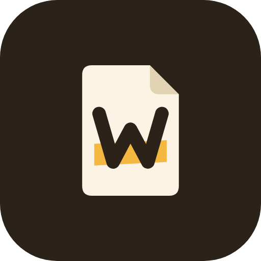
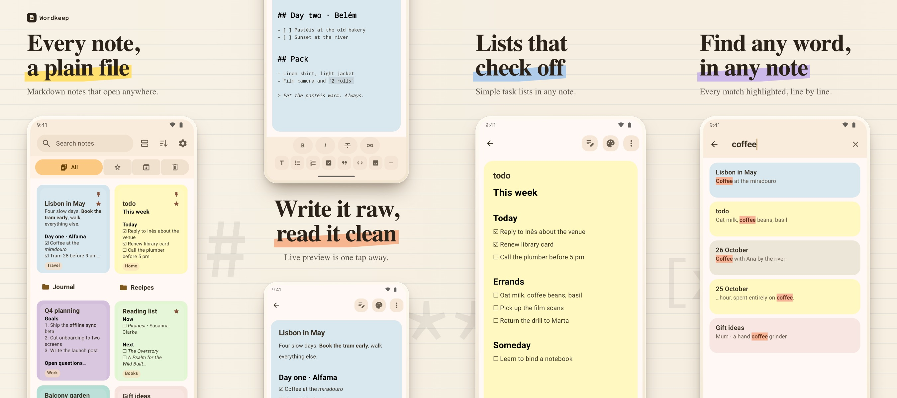
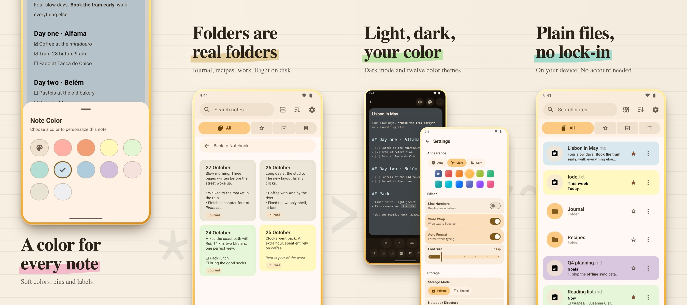
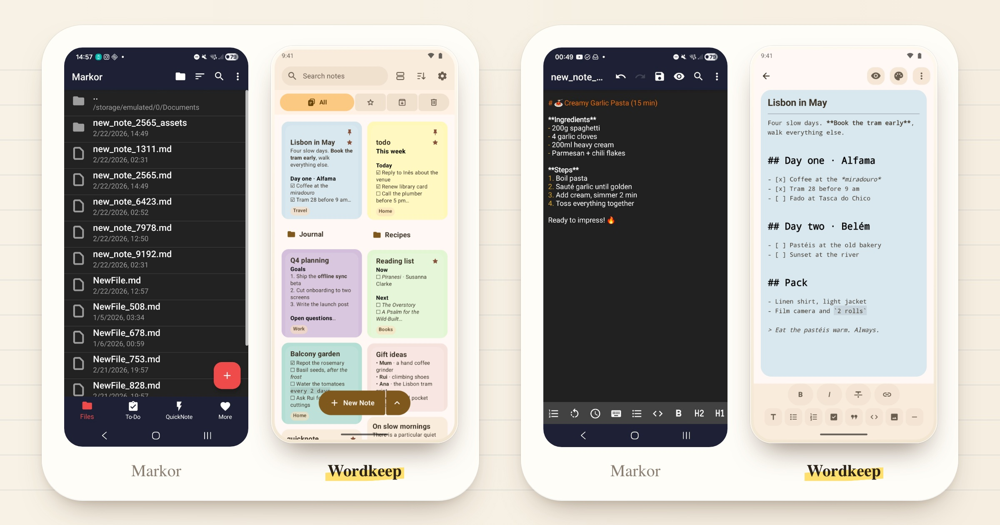
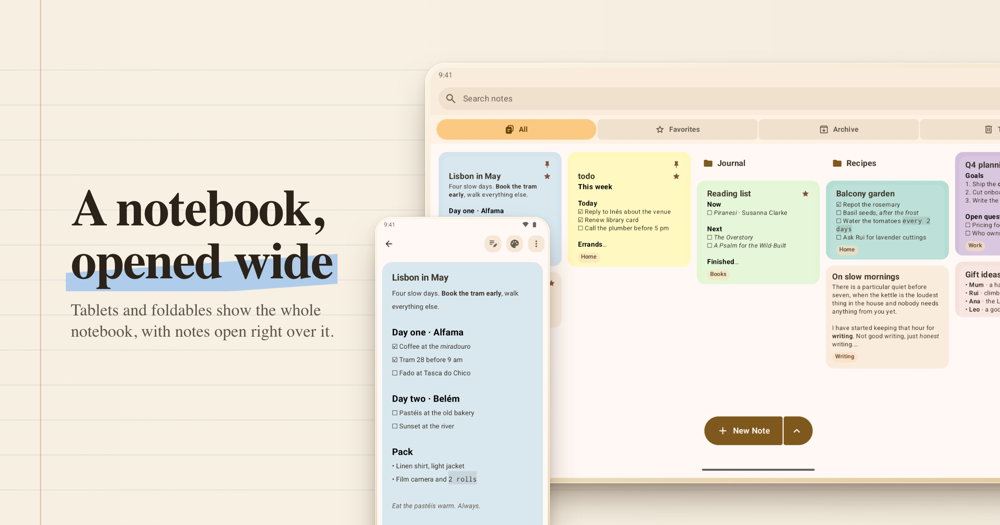

  

<h1 align="center">Wordkeep</h1>

<strong>Every note, a plain file.</strong>

Markdown notes and to-do lists for Android, iOS and the web. Write with syntax highlighting, read a clean preview, and keep every word in a file you own.

  

<a href="https://markor-five.vercel.app/"><strong>Try the web demo</strong></a>

  

## Everything a notebook needs

  

- **Markdown, kept readable.** Headings, bold, quotes and `- [ ]` tasks are highlighted as you type. One tap shows the finished page.
- **Organized your way.** Pin, star, color and label notes, archive what you are done with, and keep real folders for a journal, recipes or work.
- **Find it again.** Search runs through every note and folder and highlights each match in its line. In a long note, the outline jumps to any heading.
- **Yours to style.** Light or dark, with twelve color themes, including your wallpaper's colors.

## From Markor to Wordkeep

The same notes on the same phone, in Markor and in Wordkeep. Notes became cards you can pin, color and label; the editor keeps Markdown readable as you type.

  

Wordkeep is a modern port of [Markor](https://github.com/gsantner/markor), Gregor Santner's open-source Markdown editor. It keeps Markor's idea, plain text first and offline always, in a new implementation built with Kotlin Multiplatform and Compose.

## On a bigger screen

Notes open right over your notebook on tablets, so you never lose your place.

  

## Private by design

No account, no sign-in. Notes are plain Markdown and text files, kept in the app's private storage or in a shared Documents folder that any sync tool can reach. Licensed under [Apache 2.0](LICENSE.txt).

Building from source or contributing? See [docs/DEVELOPMENT.md](docs/DEVELOPMENT.md).
